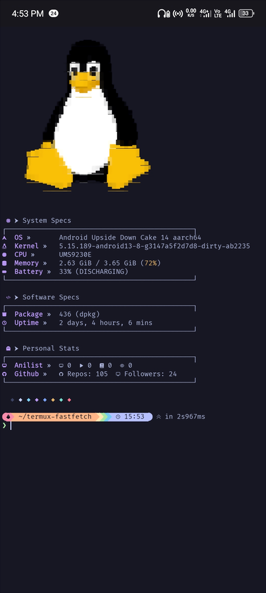

# ⚡ Termux Fastfetch Setup
A heavily customized, crash-free fastfetch setup for Android Termux with top-aligned random pixel art logo rendering via chafa and structured specification boxes.

## ✨ Features
Crash Prevention: Bypasses Termux GPU/Display segmentation fault bugs by running --logo none inside fastfetch and passing top logos externally.
Top Image Handler (ff): Randomly selects images from ~/.config/fastfetch/images and renders them cleanly with aspect-ratio protection using chafa.
Live Telemetry: Integrates native Android battery status via termux-api and real-time GitHub activity stats cached via GitHub GraphQL API.
Fixed Box Boundaries: Custom ASCII borders designed to eliminate line-wrapping and truncation on mobile screens.

## 📦 Dependencies

fastfetch
chafa
jq
termux-api
gh (GitHub CLI, for API queries)

## 🚀 Quick Start

1. Clone & Install
   git clone [https://github.com/ttylanre/termux-fastfetch.git](https://github.com/ttylanre/termux-fastfetch.git)
   cd termux-fastfetch
   chmod +x install.sh
   ./install.sh

2. Environment Setup
   Add local binary binaries to your $PATH if you haven't already (e.g., in ~/.zshrc):
export PATH="$HOME/.local/bin:$PATH"

Authenticate GitHub CLI to populate the GitHub stats module:
gh auth login

Add your favorite pixel art/logos into ~/.config/fastfetch/images/.

3. Usage
Run the wrapper command:
ff

---
